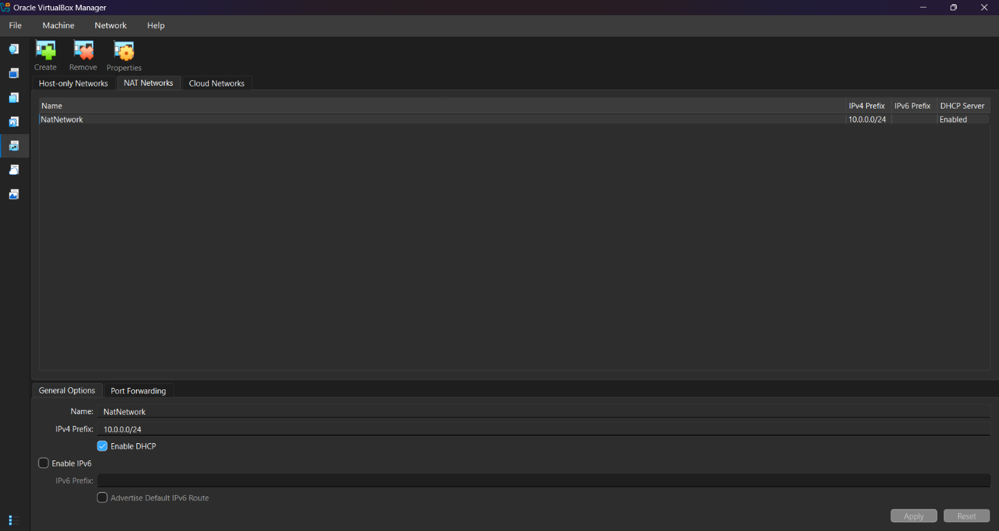
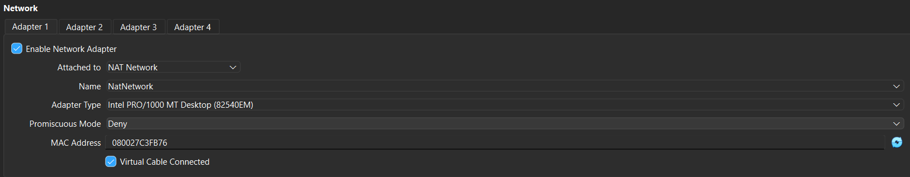
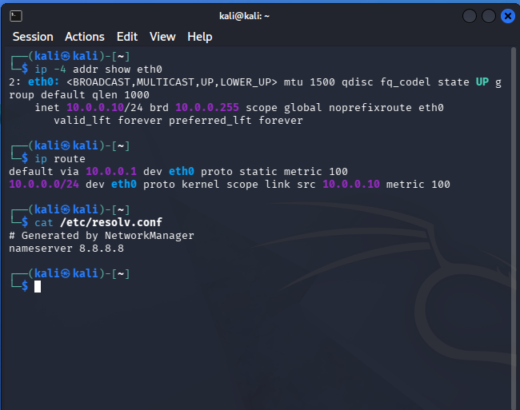
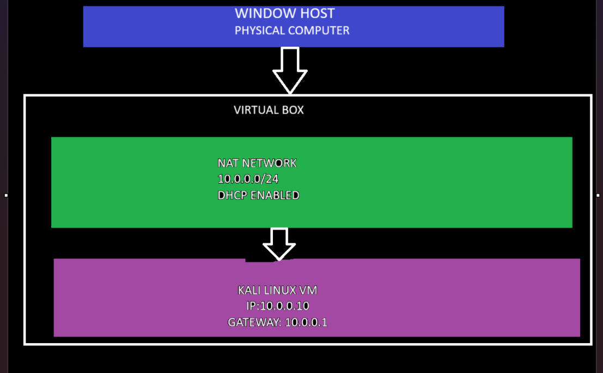
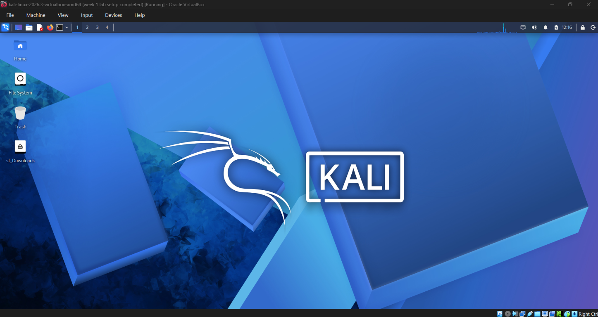

# My Cybersecurity Lab

A small virtual lab using VirtualBox and Kali Linux for learning cybersecurity basics.

## Lab setup

- **Host:** Windows laptop
- **Virtual machine software:** VirtualBox
- **Lab system:** Kali Linux
- **Network:** Private VirtualBox NAT Network

## Screenshots

### VirtualBox network

### Kali virtual machine network adapter

### Kali network configuration

### Lab layout

### Kali desktop

## Safe use

This lab is for learning and authorized practice only. Only test systems that you own or have permission to use.

## Tools

- [VirtualBox](https://www.virtualbox.org/wiki/Downloads)
- [Kali Linux](https://www.kali.org/get-kali/)

